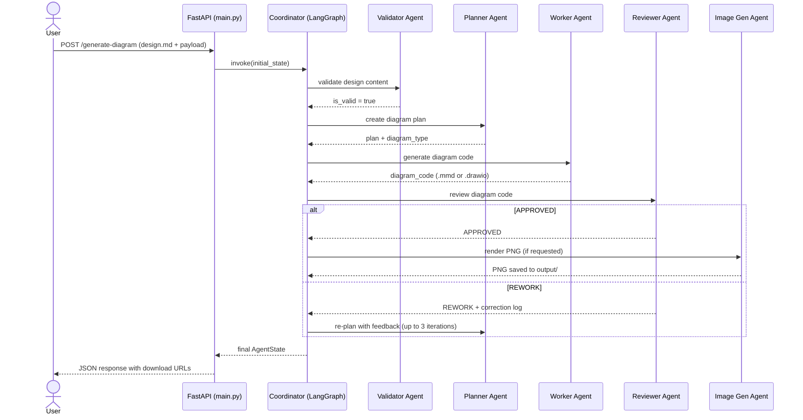

# 🤖 AI Diagram Agent

> **Turn plain-English architecture descriptions into production-quality diagrams — automatically, with self-correction.**

[](https://python.org)
[](https://fastapi.tiangolo.com)
[](https://langchain-ai.github.io/langgraph/)
[](https://openai.com)
[](LICENSE)

---

## 🎯 Business Objective

Architecture diagrams are a universal language for technical communication — yet they remain one of the most time-consuming, manually intensive artefacts in the software delivery lifecycle. Teams spend hours in diagramming tools translating their mental models into visual flows, only to redo them after every design review.

**AI Diagram Agent solves this by treating diagram generation as a software problem:**

- ✅ Describe your system in plain English (Markdown)
- ✅ The agent pipeline determines the right diagram type, generates the code, self-reviews, corrects, and delivers a download-ready file
- ✅ Supports **Mermaid.js** (`.mmd`, interactive HTML, PNG image) and **Draw.io** (`.drawio`) formats
- ✅ Zero manual diagramming — from intent to artefact in seconds

This is especially powerful for **AI Architects, Solution Architects, and Platform Engineers** who need to communicate complex flows quickly — for RFCs, design reviews, client presentations, and runbooks.

---

## 🏗️ How I Built It

### Technology Choices

| Layer             | Technology                     | Why                                                                                      |
| ----------------- | ------------------------------ | ---------------------------------------------------------------------------------------- |
| **Orchestration** | LangGraph (StateGraph)         | Stateful, graph-based multi-agent control flow with conditional routing and loop support |
| **LLM**           | OpenAI GPT-4o via LangChain    | Best-in-class structured code generation and self-critique                               |
| **API**           | FastAPI + Uvicorn              | Async, production-ready REST API with file upload support                                |
| **Rendering**     | Playwright (headless Chromium) | Pixel-perfect PNG rendering of Mermaid HTML and Draw.io viewers                          |
| **Runtime**       | Python 3.10+, uv               | Modern Python toolchain with fast dependency resolution                                  |

### How the Pipeline Works

The system is a **self-correcting agentic loop** — each request flows through a deterministic graph of specialised agents:

```
Your design.md
      │
      ▼
  [Validator] ──── unclear? ──── END (with questions)
      │
   valid ✓
      │
      ▼
  [Planner]  ── determines: Sequence / Class / Flowchart / State
      │
      ▼
 [Worker Selector]
   ┌──┴──┐
   │     │
[Mermaid] [Draw.io]  ← generates diagram source code
   └──┬──┘
      │
      ▼
  [Reviewer] ── APPROVED ──► [Image Gen] ──► PNG
      │
   REWORK
      │
      └──► back to Planner or Worker (max 3 iterations)
```

The **self-correction loop** is a key differentiator: the Reviewer agent audits the generated code against the original design intent and flags issues. Correction logs are injected into subsequent iterations so the LLM learns from its mistakes within the same request.

### Sequence Diagram



---

## 📁 File Dictionary

| File / Folder              | Purpose                                                            |
| -------------------------- | ------------------------------------------------------------------ |
| `main.py`                  | FastAPI app — `/generate-diagram` and `/download/{path}` endpoints |
| `coordinator.py`           | LangGraph `StateGraph` — wires all agents, defines routing logic   |
| `agents/validator.py`      | Validates design clarity before processing                         |
| `agents/planner.py`        | LLM-based diagram type detection and planning                      |
| `agents/mermaid_worker.py` | Mermaid.js code generation + HTML viewer output                    |
| `agents/drawio_worker.py`  | Draw.io XML generation (Sequence, Class, Flowchart, State)         |
| `agents/reviewer.py`       | LLM-based code auditor — APPROVED or REWORK with log               |
| `agents/image_gen.py`      | Playwright headless PNG rendering                                  |
| `design.md`                | Example input design file                                          |
| `output/`                  | Generated diagrams (`.mmd`, `.html`, `.png`, `.drawio`)            |
| `logs/`                    | Per-iteration plan and review logs                                 |
| `pyproject.toml`           | Python project metadata                                            |
| `setup.bat` / `setup.sh`   | One-command environment setup scripts                              |
| `developer.readme.md`      | Full developer guide (setup, API, extension, troubleshooting)      |

---

## 🚀 Quick Start

```bash
# 1. Clone the repo
git clone https://github.com/himadri-majumdar/ai-diagram-agent
cd ai-diagram-agent

# 2. Install dependencies (using uv)
uv sync
.venv\Scripts\activate   # Windows
# source .venv/bin/activate  # Linux/macOS

# 3. Install Playwright browser
playwright install chromium

# 4. Configure environment
echo OPENAI_API_KEY=sk-your-key > .env
echo MODEL_NAME=gpt-4o >> .env

# 5. Start the server
uvicorn main:app --reload

# 6. Generate your first diagram
curl -X POST "http://127.0.0.1:8000/generate-diagram" \
     -F "design_file=@design.md" \
     -F '{"output_format": "mermaid", "generate_image": true}'
```

> See **[developer.readme.md](./developer.readme.md)** for full setup instructions, API reference, and extension guide.

---

## 🔭 Scope for Improvement

The current version is a working proof-of-concept. The following areas are on the roadmap:

| Area                 | Improvement                                                                    |
| -------------------- | ------------------------------------------------------------------------------ |
| **Output Formats**   | Add PlantUML, Structurizr DSL, and Excalidraw support                          |
| **Diagram Types**    | Extend to Entity-Relationship, Gantt, Mindmap, and C4 model diagrams           |
| **UI**               | Build a React/Next.js front-end with live diagram preview                      |
| **Streaming**        | Stream agent progress events via Server-Sent Events (SSE)                      |
| **Validation**       | Integrate Mermaid CLI (`mmdc`) for syntax validation before LLM review         |
| **Multi-LLM**        | Support Anthropic Claude, Google Gemini, and Azure OpenAI as drop-in providers |
| **Persistence**      | Replace file-based output with S3/blob storage and a session database          |
| **Auth**             | Add API key / OAuth2 authentication to the FastAPI layer                       |
| **Observability**    | Integrate LangSmith tracing for full agent run visibility and cost tracking    |
| **Batch Processing** | Accept multiple design files in a single request                               |
| **Feedback Loop**    | Allow users to rate and correct outputs to fine-tune the reviewer prompt       |

---

## 🧠 Key Technical Concepts Demonstrated

- **Agentic AI Design** — Multi-agent systems with specialised roles, shared state, and conditional routing
- **Self-Correcting Loops** — Automated feedback injection across LLM iterations
- **LangGraph StateGraph** — Production-grade agent orchestration beyond simple chains
- **Prompt Engineering** — Context-rich, format-constrained prompts for reliable structured output
- **Headless Rendering** — Playwright for deterministic image generation from web content
- **FastAPI File Handling** — Multipart form uploads, dynamic file serving, path security

---

## About Me

I'm an **Enterprise & AI Solution Architect** with hands-on experience in **platform engineering, cloud-native architecture, AI tooling, and developer experience**. The AI Diagram Agent is a concrete example of how I approach problems: identify a real operational gap (manual diagramming bottleneck), design a minimal but production-quality agentic solution, ship it end-to-end, and validate it with the tools that built it.

My focus is on **pragmatic AI architecture** — building systems that are explainable, cost-aware, and production-ready from day one, not just impressive demos.

📧 [majumdar.himadri@gmail.com](mailto:majumdar.himadri@gmail.com)
🔗 [LinkedIn — Himadri Majumdar](https://www.linkedin.com/in/himadri-majumdar)

---

_For detailed developer documentation, see [developer.readme.md](./developer.readme.md)._
